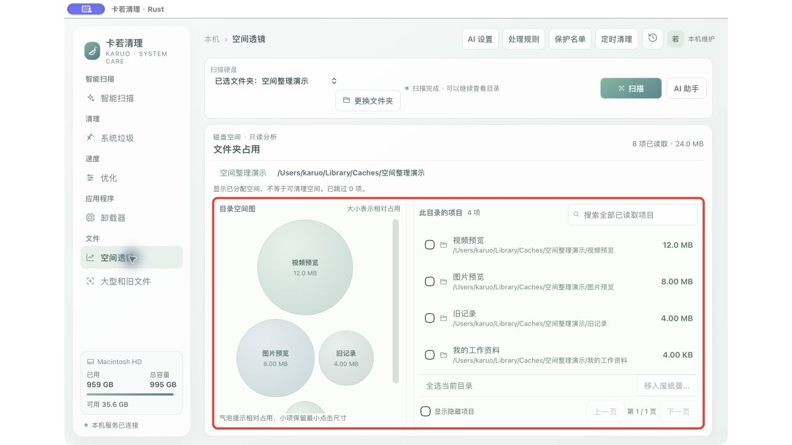
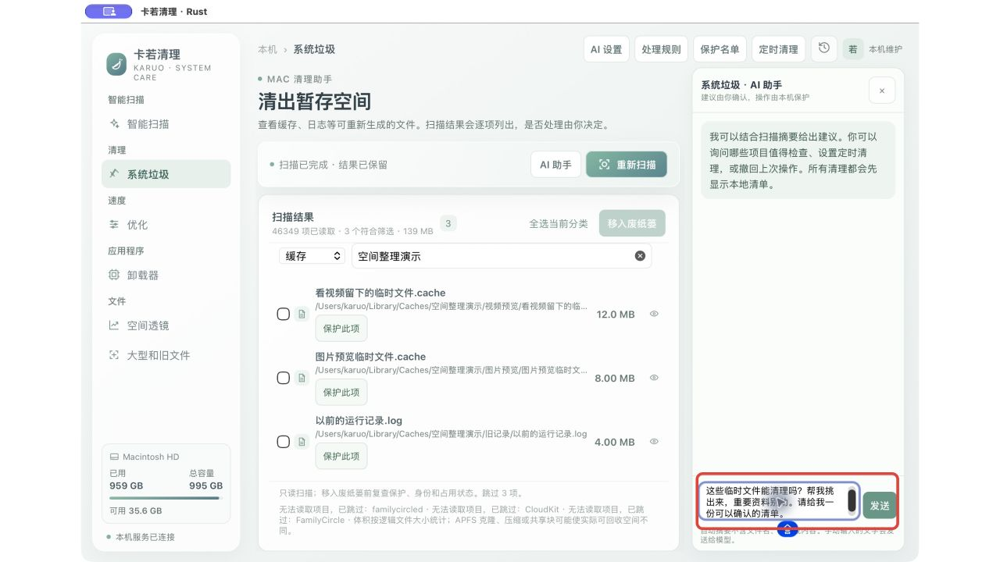
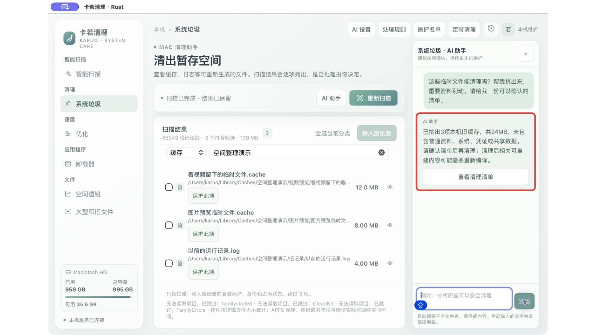

# 卡若清理 · Karuo Cleaner

**电脑空间不够？先看清，再清理。**

文件越攒越多，却不知道该从哪里下手？卡若清理帮你找出占空间的文件。不知道能不能删，就直接问 AI。看懂清单，再决定要不要清理。

[下载 Mac 版](https://github.com/fnvtk/karuo-cleaner-rs/releases/tag/v1.4.0)

## ① 谁占空间多，一眼就看见

**红框看这里：圆越大，占的空间越多。** 旁边列出文件夹和大小，点进去还能继续看。不用一个文件夹一个文件夹翻，先找最值得整理的地方。

可以选择硬盘，也可以只看某个文件夹。切到别的页面，扫描仍会继续，回来还能接着看。

## ② 不知道该删什么？直接问

**红框看这里：像聊天一样，说出你想做的事。**

> 这些临时文件能清理吗？帮我挑出来，重要资料别动。

AI 就在清理页面旁边。看着文件问，不用来回切页面，也不用先学一堆电脑术语。

## ③ AI 帮你挑，你来做决定

**红框看这里：告诉你挑了什么，再让你查看清单。** 这次演示中，助手挑出了 3 项旧临时文件，共 24 MB，并提醒清理后的影响。

点「查看清理清单」，核对具体项目，再确认处理。不是给你一大段话就结束，而是帮你走到可以动手的下一步。

*以上为真实软件使用演示文件的截图。图中数字仅用于展示操作，实际可清理空间以你的电脑为准。占用大，也不代表一定该删。*

## 整理电脑，可以省这些心

| 你遇到的烦恼 | 卡若清理怎么帮你 |
| --- | --- |
| 不知道空间去哪了 | 空间透镜把大小摆出来，大文件更容易找 |
| 临时文件越攒越多 | 扫描后列出候选项目，按分类挑选 |
| 不确定能不能删 | 在当前页面问 AI，看建议、看清单再决定 |
| 不想碰重要资料 | 重要项目可以加入保护名单，AI 也不能越过保护规则 |
| 担心清理后反悔 | 先移入废纸篓，支持最近一批撤回和清理历史恢复 |
| 总忘记整理 | 可以设置定时扫描，也可以让 AI 帮你拟好定时设置 |
| 软件不再用了 | 查找应用和有关文件，核对后再处理，共享资料会保留 |

移入废纸篓后，空间不会马上全部释放。撤回和恢复需要文件仍在废纸篓中；永久删除后无法撤回。最近一批撤回用于本次打开期间，更早的记录请到清理历史中恢复。

## 让清理更合你的习惯

右上角打开「清理管家」，设置临时文件保留多久，查看定时检查的结果。你恢复过的文件，以后自动清理会避开。自动整理只在你已启用的定时范围内进行。

当前为本机管家功能；卡若AI网站Agent尚待正式授权绑定。

## 三步开始

1. 下载并解压，把「卡若清理.app」拖进「应用程序」。
2. 选择硬盘或文件夹，点击「扫描」。
3. 看清结果，勾选想整理的项目；拿不准就问旁边的 AI。

使用 AI 前，在「AI 设置」中连接可用的服务。自动提供给 AI 的扫描摘要不包含文件名、路径或文件内容；你在聊天中主动输入的文字会发送给所连接的服务。

## 下载前看一眼

当前安装包适用于 Apple 芯片的 Mac，系统需要 macOS 13 或更新版本。此版本尚未通过 Apple 公证，能否打开取决于电脑的安全设置。

想了解构建方法或对接工具？请看 [开发说明](docs/开发说明.md) 和 [接口说明](API/README.md)。
