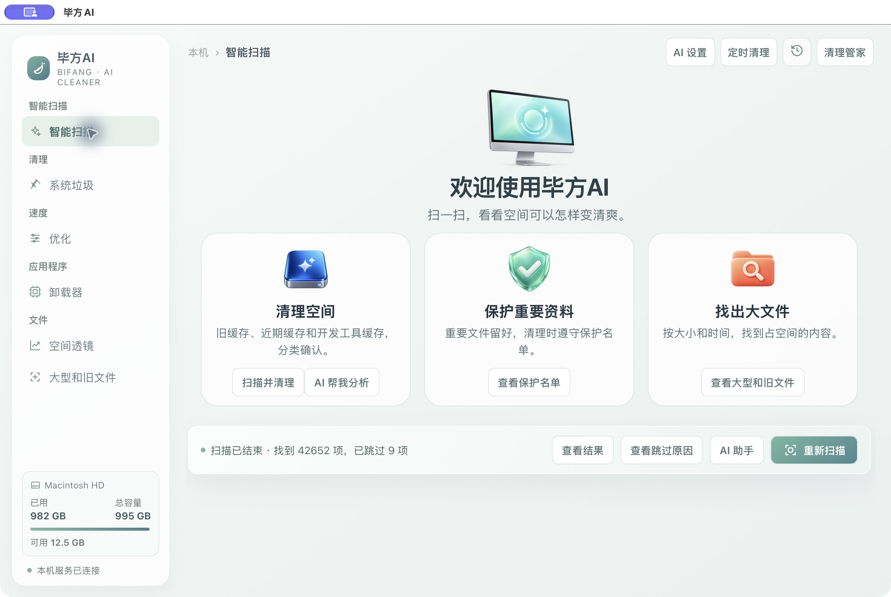
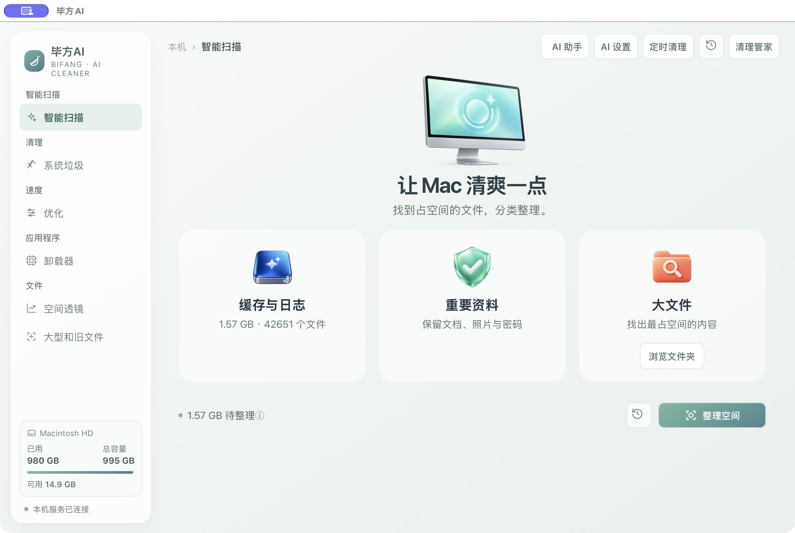

# 毕方AI：少点按钮，直接整理

## 修改前

首页同时出现“扫描并清理”和“重新扫描”，AI入口也重复；结果、跳过原因挤在同一行，让人难以判断该点哪个。

## 修改后

1. 首页只保留一个“整理空间”主按钮；重新扫描缩成带说明的图标。
2. AI集中在右上角。说“帮我整理”，AI会直接准备分类清单，默认只推荐旧缓存和日志；近期缓存、开发下载缓存保留人工选择。
3. 清单先用文件夹图标展示类别、文件数和大小；需要时再展开文件明细。
4. 确认后才移入废纸篓，可以在清理历史中撤回。跳过的项目保留在小信息图标里。

本次参考CleanMyMac在本机的首页：一个主扫描操作、图标说明和渐进展示。深层删除策略未取得新的二进制反编译证据，不能声称与它完全相同。界面截图不代表已清理文件，也不把文件逻辑体积写成已释放磁盘空间。

本轮验证：真实AI准备清单、隔离测试文件移入废纸篓、精确撤回成功；迟到回复、失败回复不会触发清理。首页已在本机查看。最终安装版采用完整应用包原子更新，正在运行的文件处理不被终止，新版在下次启动时启用。
