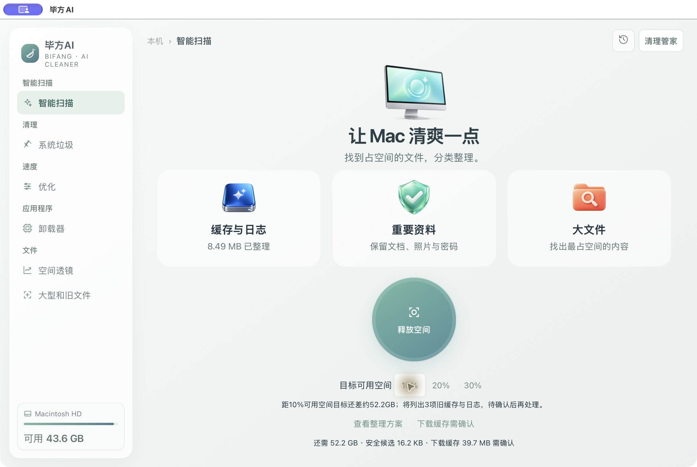

# 少一点操作，多一点空间

## 文字随手贴
AI对话框、搜索和设置输入框支持Mac常用的全选、复制、剪切、粘贴、撤销和重做。直接使用键盘快捷键，也可以打开菜单栏的“编辑”。

## 目标交给AI来算
选择10%、20%或30%，毕方AI会扫描旧缓存和日志，把实际可用空间、目标缺口、可整理大小和清理习惯交给AI分析。页面里显示方案；点击“查看整理方案”可检查并处理已核实的候选。选择目标只分析，不会直接删除。

过期下载缓存单独显示，需要你确认。可安全整理的内容不足时，会如实显示差距，不会为了达标清掉重要文件。网络或模型不可用时明确显示本机规则方案。

## 向MOLE经验学习，保留重要东西
参考[本机 - MOLE清理](codex://threads/019fde2a-0001-7113-bb18-ca9c3f57f5e7)中的实操经验：新增超过30天的npx临时包缓存审阅，近期使用的临时包、项目自己的node_modules保留。Node或包管理任务正在运行时，npx缓存不会移走。

Next.js运行文件、Docker数据卷与虚拟磁盘、数据库、发布和验收引用、唯一备份保留。“只留一份回退备份”需要先核实项目、来源、用途和引用关系，当前不会按文件夹名字自动删除备份。

## 这次如何检查
- 实际键盘验证全选、复制、剪切和粘贴：剪切后清空，粘贴后恢复，未发送测试文字。
- 10%、20%、30%和真实空间缺口进入模型请求；匿名上下文不含文件名与路径。
- 过期npx包进入需确认清单，近期包和项目依赖排除；6个隔离文件保持原样。
- 真实AI接口完成可恢复清理验证，5个测试文件全部恢复，未执行永久删除。
- 本机管家可用；网站清理Agent尚未绑定。Codex侧栏项目与网站Agent是两件事。
