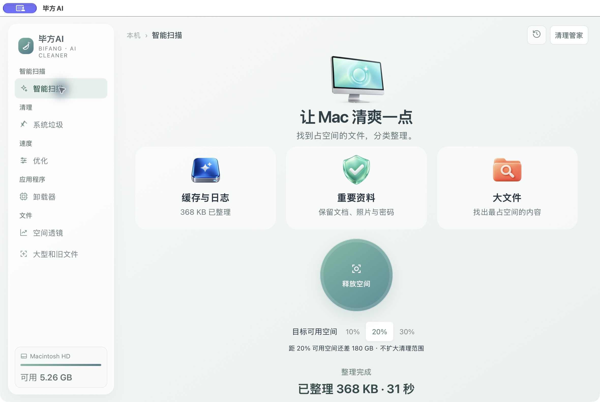

# 留出空间，少一点操心

选择10%、20%或30%，告诉毕方AI你希望硬盘留出多少可用空间。它会参考以前清过哪些类型、哪些目录，以及你撤回过的记录。重要资料与保护名单优先。

系统垃圾和大型文件按文件夹一起选择。选择一个文件夹，只会处理本次扫描中符合规则的文件，里面的其他资料会留下。

整理后可以撤回。需要真正释放时，页面里直接显示本批数量和大小，点击“确认永久释放”才会继续；此后无法撤回。不会清空废纸篓里的其他东西。

目标是愿望，不是删除额度。安全候选不够时会显示差额，不会为了达到比例扩大删除范围。AI得到的是匿名统计，不会收到历史文件名或路径。

本版已验证：三档目标保存、非法目标拒绝、目录批量范围、页面内确认与取消、真实AI分析、实际移入废纸篓、重启保留结果、5个隔离测试文件全部恢复。没有在验证中执行永久删除。
