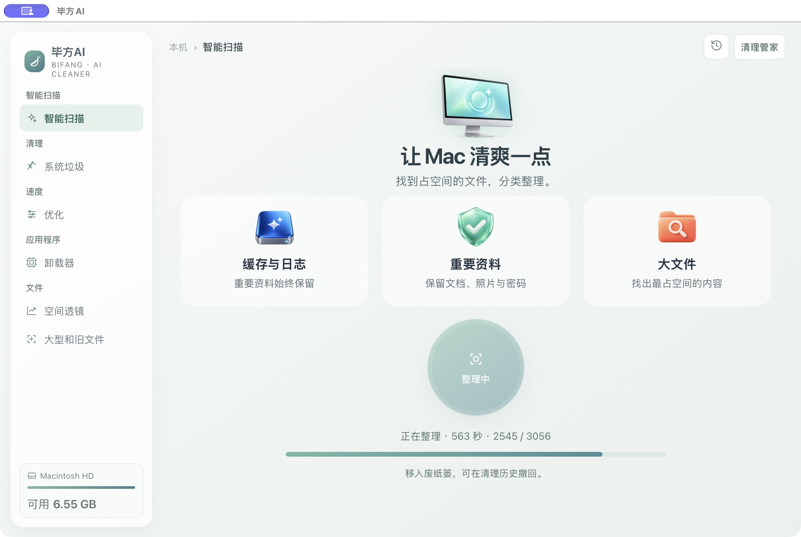
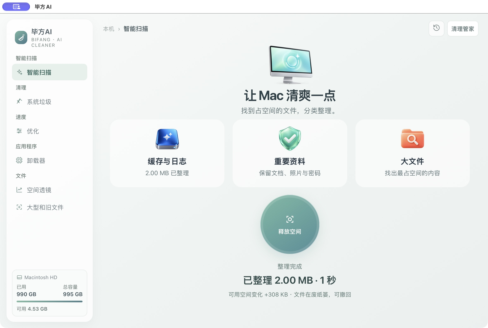
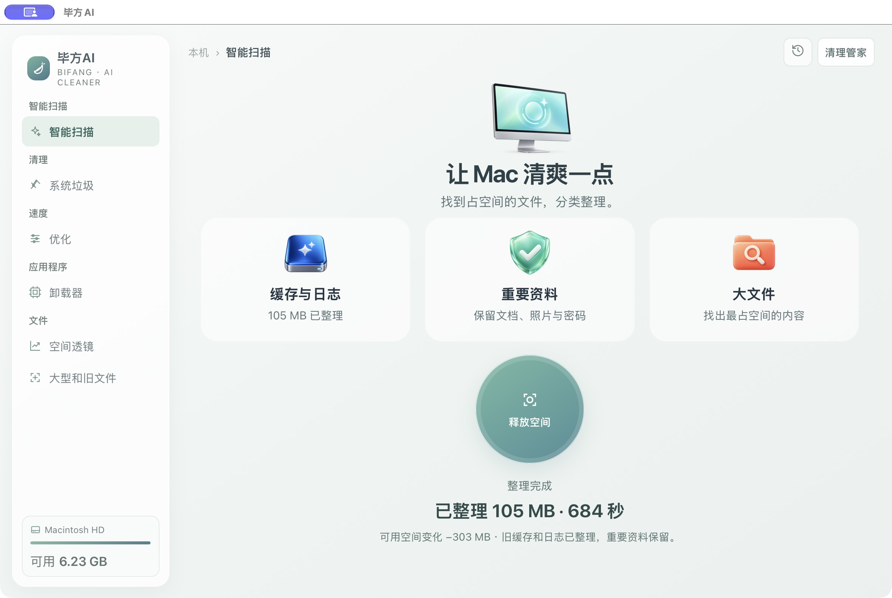

# 一颗按钮，在首页整理

点中间的「整理空间」，毕方会扫描、审核、核验并整理旧缓存和日志。进度就在按钮下面，不跳转、不翻文件清单。结束后显示整理了多少、花了多久，以及磁盘实际可用空间的变化。

顶部只留下清理历史和清理管家。AI助手、AI设置、定时清理、保护名单都收进管家。其他页面也收起了重复说明。

近期缓存、开发下载缓存、文档、照片、密码等重要资料不会被这个按钮默认处理。正在使用或校验不通过的文件会保留。

## 整理后可以撤回

上图仅为隔离测试文件的完成画面，不是用户磁盘释放报告。文件先移入废纸篓，在清理历史中可以撤回。需要真正永久释放时，点击同一位置的「释放空间」，再由你确认；这一步无法撤回。

「已整理」是移入废纸篓的文件大小；「可用空间变化」是系统实际读数，可能同时受到其他程序和APFS延迟影响。不会把前者假装成已经释放的空间。

## 本机完成效果

本次实际整理3053项旧缓存与日志，文件大小约105MB；另3项未处理。耗时约11分24秒。结束时系统可用空间读数比开始少约303MB，因此不能说释放了105MB。文件仍可撤回，永久释放需另行确认。完成信息重开应用后也会保留。
